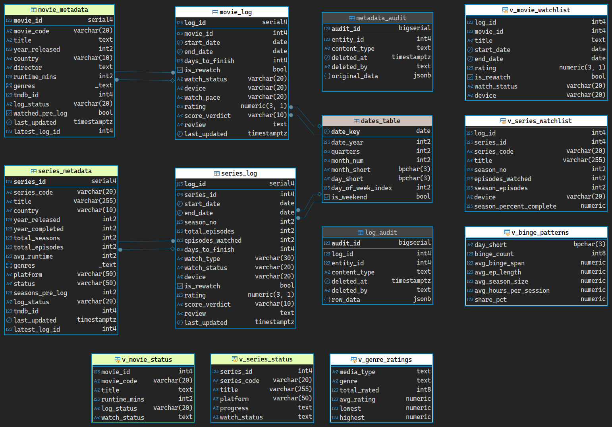

# CinePipe

I used to track what I watched using spreadsheets. Then, while I was learning SQL (specifically psql), I decided to try building something more useful with it. This started as a fun side project: a database that logs what I watch, when I start and finish it, and other details about each movie or show.

Later I took it further and added Python and the TMDB API. The scripts fetch metadata about whatever I'm about to watch, and stored procedures register it in the database.

Want the full detail? The [complete documentation](docs/database-documentation.md) covers every table, trigger, procedure and view.

* * *

## How It's Wired



| Table | What it stores |
|---|---|
| `dates_table` | A pre-generated calendar. Every watch log points to a date in here, so date-based reports need no messy joins. |
| `series_metadata` | One row per show: title, TMDB ID, genres, total episodes, and so on. |
| `movie_metadata` | One row per film: title, TMDB ID, genres, runtime, and so on. |
| `series_log` | One row per season I watch. A rewatch gets its own row. |
| `movie_log` | One row per movie watch. |
| `metadata_audit`, `log_audit` | A copy of every deleted row, saved as JSONB. My recycle bin. |

* * *

## Project Structure

```
cinepipe/
├── sql/
│   ├── 1-tables.sql
│   ├── 2-procedures.sql
│   ├── 3-triggers.sql
│   ├── 4-views.sql
│   └── 5-sample-data.sql
├── py/
│   ├── add_metadata.py      -- Looks up a title on TMDB and registers it
│   ├── update_series.py     -- Refreshes one series from TMDB
│   └── update_all.py        -- Refreshes every series from TMDB
├── docs/
├── images/
└── README.md
```

To set it up, run files 1 to 4 in order, because each one depends on the one before it. File 5 is optional: a small sample library for an empty database. The [setup guide](docs/getting-started.md) has the details.

* * *

## How It Works

**Stored procedures.** I decided early on that I wouldn't write directly to any table. Every write goes through a stored procedure, so it follows the same rules whether it comes from a Python script or a manual query. `add_metadata` registers a new show or movie, and `series_watch` and `movie_watch` record a watch session.

**Triggers.** Trigger functions run in the background whenever data changes. They tidy titles and genres, build a short code for each title (like `BOB-11` for Bob's Burgers, 2011), flag rewatches, work out whether a season is finished, turn a rating into a verdict like Good or Excellent, and copy every deleted row into the recycle bin.

**Views.** The logs are only useful if I can ask them things. The views show what I'm in the middle of watching, where each series and movie stands, my binge habits, and how my opinion changed when I rewatched something.

That last one is my favourite. This is Season 1 of Bob's Burgers. I watched it before I started logging, so the first row has nothing to compare against. The second row compares itself with the first.

| series_code | season_no | rewatch_no | old_watch | old_rating | new_rating | change | verdict |
|---|---|---|---|---|---|---|---|
| BOB-11 | 1 | 1 | Original (Not Logged) | | 8.0 | | No Rating To Compare |
| BOB-11 | 1 | 2 | Rewatch 1 | 8.0 | 9.5 | 1.5 | Went Up |

**Python.** The three scripts in `py/` talk to the TMDB API. They read the database login from the standard PostgreSQL environment variables (`PGDATABASE`, `PGUSER`, `PGPASSWORD`, `PGHOST`, `PGPORT`) and the TMDB key from `TMDB_API_KEY`, so nothing private is in the code.

**Two copies.** The database lives in two places: a local copy that I log into, and an online Supabase mirror. The tooling that keeps them in sync is specific to my setup, so it isn't in this repo.

* * *

## Docs

| Document | What it covers |
|---|---|
| [Database Documentation](docs/database-documentation.md) | The full reference: tables, triggers, procedures, views and known quirks |
| [Setup Guide](docs/getting-started.md) | Prerequisites, SQL execution order, and verification steps |
| [System Audit](docs/system-audit.md) | The recycle bin, data recovery, and trigger health checks |
| [View Architecture & Indexing](docs/view-indexing.md) | The views and the genre index |

* * *

## Tech Stack

- **Database:** PostgreSQL 17, with a Supabase mirror
- **Database Language:** SQL / PL/pgSQL
- **Scripting:** Python 3
- **External API:** TMDB API
- **Tooling:** DBeaver, VS Code
- **Visualisation:** Power BI
