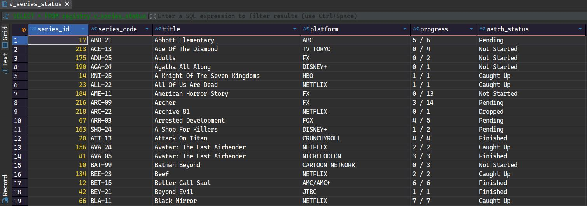
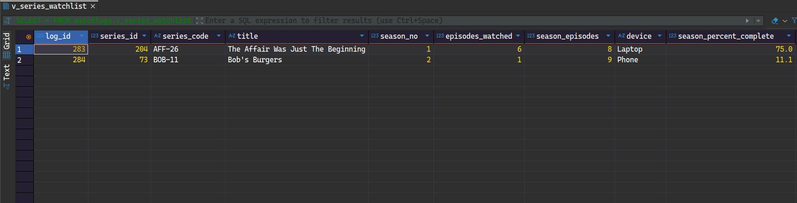
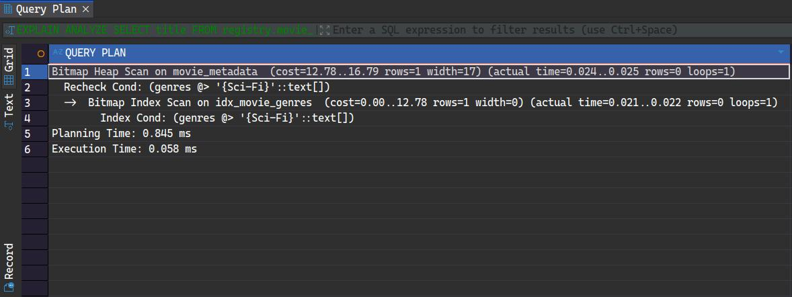
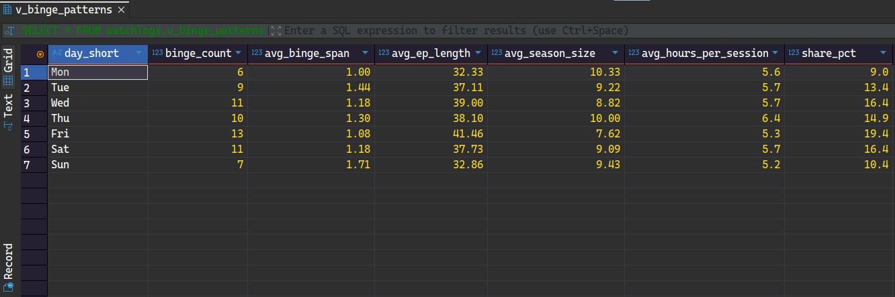

# View Architecture and Indexing Strategy

This document covers the analytical layer built on top of the raw tables: the views that Power BI connects to, the GIN index used for genre-based queries, and a view that shows which days of the week I start my binges. For everything else, see the [full documentation](database-documentation.md).

---

## 1. Analytical Views

Rather than querying the raw log tables directly from Power BI, I built a view layer that consolidates the joins, calculations, and status logic into clean, flat outputs. This keeps the raw tables normalized and moves the complexity into one place.

### `v_series_status`: Series Progress Monitor

The main view powering the series dashboard in Power BI. It lives in the `registry` schema and gives one row per series. It joins `series_metadata` with `series_log` and calculates:

- A single `progress` value like `3 / 5`, which counts both the seasons I watched before logging started (manually entered backlog data) and the seasons finished in the logs
- A derived `watch_status` tag, checked in this order:

| Status | When |
|---|---|
| `Watching` | A first watch of a season is in progress |
| `Rewatching` | A rewatch of a season is in progress |
| `Caught Up` | Every season out so far is done, and the show is still airing |
| `Finished` | Every season is done, and the show is no longer airing |
| `Dropped` | I dropped a season |
| `Pending` | Some seasons are done, but not all |
| `Not Started` | Nothing watched yet |



### `v_series_watchlist`: Active Watch Queue

A focused daily-use view that keeps only seasons that are `Ongoing` or `On-Hold`, so finished and dropped seasons never show up. It uses the latest log of each season and calculates the completion percentage of that season (`season_percent_complete`), so I can see at a glance exactly where I left off. The seasons closest to the end come first.



---

## 2. GIN Indexing for Genre Queries

Genres are stored as a PostgreSQL text array directly on each metadata row (e.g., `ARRAY['Drama', 'Thriller']`), rather than in a separate junction table. This keeps the schema flat and simple.

The trade-off is that array columns aren't natively supported by standard B-Tree indexes. To keep genre-based lookups fast, I created a **GIN (Generalized Inverted Index)** on the `genres` column of both metadata tables (`idx_series_genres` and `idx_movie_genres`). A GIN index works like the index at the back of a book: it maps each individual array element to the rows that contain it, so the database can find all rows matching a specific genre without scanning the entire table.

### Verifying the Index is Being Used

I used `EXPLAIN ANALYZE` to confirm the query planner is using the GIN index rather than falling back to a sequential scan:

```sql
EXPLAIN ANALYZE
SELECT title
FROM registry.movie_metadata
WHERE genres @> ARRAY['Sci-Fi']::text[];
```



The query plan shows a **Bitmap Index Scan** on `idx_movie_genres`: the GIN index finds the rows that contain the genre, and a **Bitmap Heap Scan** then reads only those rows from the table, instead of checking every row. On this dataset the whole query executes in 0.058 ms. No movie in my library carries this exact genre label, so the query returns no rows, but the plan shows how a genre lookup goes through the index.

---

## 3. Binge Patterns

### `v_binge_patterns`: Which Days I Start My Binges

This view answers a simple question: on which days of the week do I start a binge? It only looks at seasons logged with the watch type `Binge`, and groups them by the weekday of the start date.

It works because of the calendar table. Each log's start date is joined to `dates_table`, which already knows the weekday of every date, so the view needs no date arithmetic of its own. It also joins `series_metadata` for the average episode length. The result has one row per weekday, from Monday to Sunday, and days with no binges don't appear.

| Column | Meaning |
|---|---|
| `day_short` | The weekday (Mon, Tue, and so on) |
| `binge_count` | How many binges started on that day |
| `avg_binge_span` | Average number of days from start to finish. A season with no end date yet counts as 1 day |
| `avg_ep_length` | Average episode length of those shows, in minutes |
| `avg_season_size` | Average number of episodes in those binges |
| `avg_hours_per_session` | Estimated hours per binge: average episode length times average season size, divided by 60 |
| `share_pct` | That day's share of all my binges, as a percentage |

